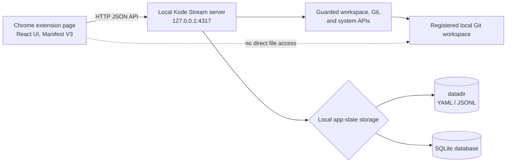

# Chrome Extension Architecture

The Chrome extension is an unpacked Local-mode showcase. It packages the React UI as a Manifest V3 extension page.
All privileged work stays in a separately started local Kode Stream server, which keeps enforcing the guarded
filesystem and Git APIs.

Source: [chrome-extension.mmd](chrome-extension.mmd).

Origin rules and limits: [extension reference](../../../wiki/platform/extension-reference.md). Build, load and
troubleshooting: [Chrome extension showcase](../../../deploy/chrome-extension.md).
