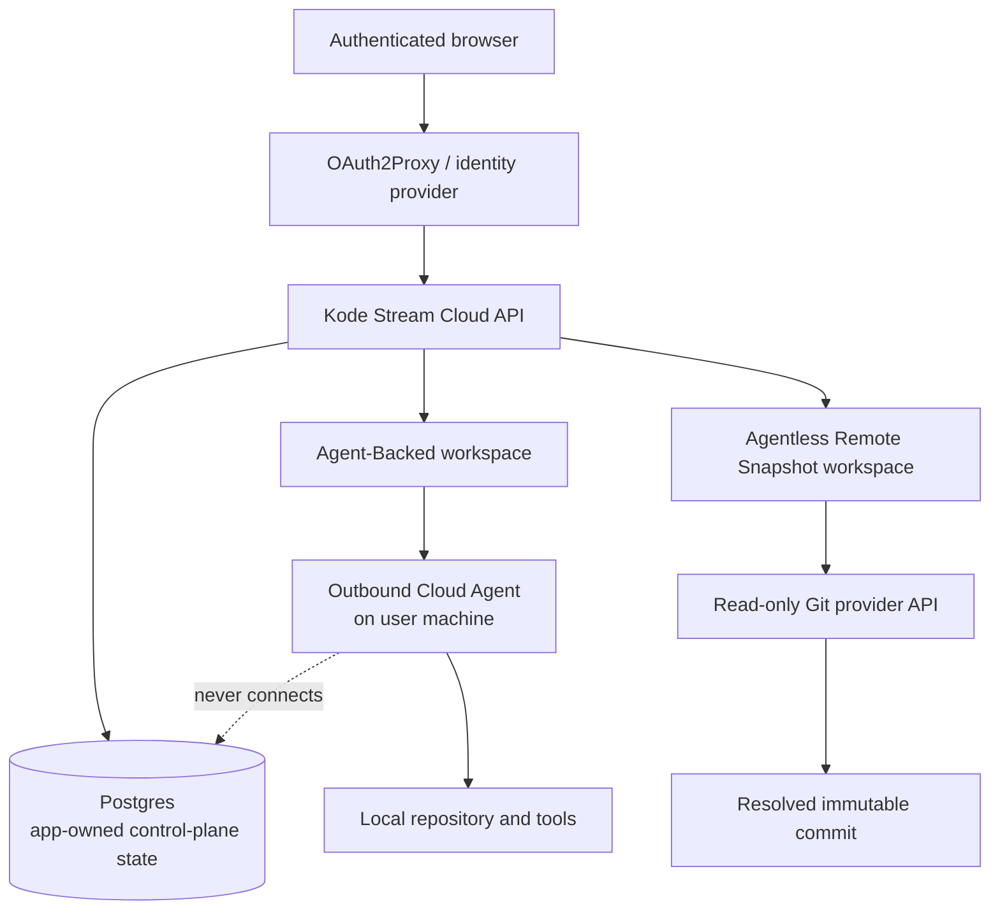

# Cloud Mode Architecture

Cloud mode is a hosted control plane, not a hosted checkout or terminal. It authenticates users through OAuth2Proxy,
stores shared app state in Postgres and offers two workspace access modes.

Sources: [cloud-mode.mmd](cloud-mode.mmd), [agent-backed.mmd](agent-backed.mmd),
[agentless-remote-snapshot.mmd](agentless-remote-snapshot.mmd), [postgres-storage.mmd](postgres-storage.mmd).

Cloud always runs `KODE_STREAM_STORAGE_OPTION=database` with `KODE_STREAM_STORAGE_DRIVER=postgres` and a
secret-managed `KODE_STREAM_DATABASE_URL`.

What each access mode can do today is in the
[Cloud runtime reference](../../../wiki/platform/cloud-runtime-reference.md). Environment, authentication,
troubleshooting and upgrades are in [Cloud deployment](../../../deploy/cloud-deployment.md).
