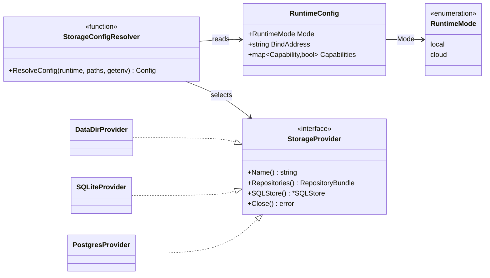
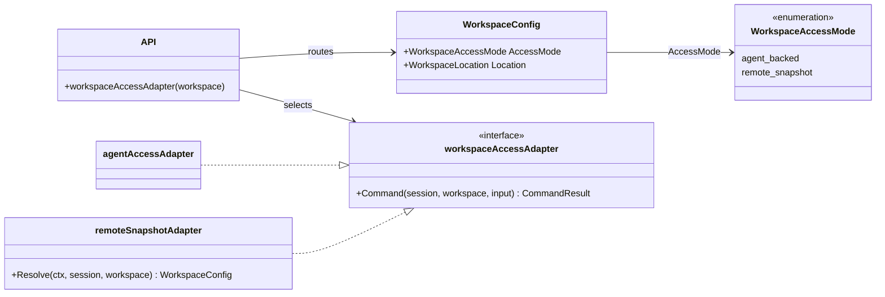
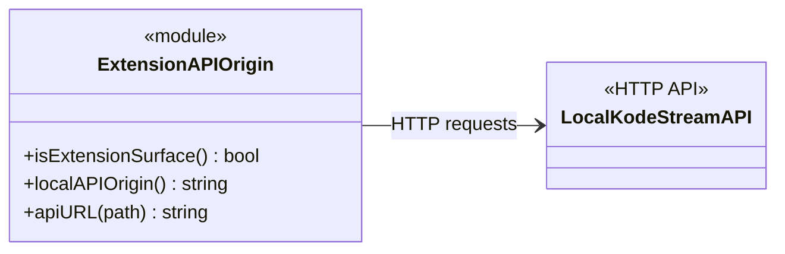

# Deployment Adapter Class Diagrams

Kode Stream has no single `DeploymentMode` interface. Each deployment concern varies behind its own small abstraction.

## Runtime And Storage

`RuntimeConfig` supplies policy to storage configuration. `StorageProvider` is the persistence seam.

## Cloud Workspace Access

The API picks the command adapter from a workspace's `AccessMode`.

## Chrome Extension Surface

The extension only chooses the local API origin. It has no server-side runtime or workspace-access adapter.

