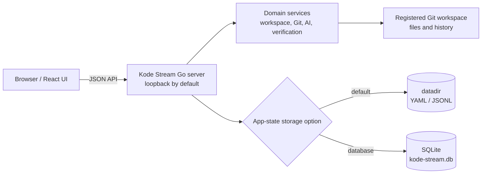

# Local Mode Architecture

Local mode is the single-user runtime. The Go server binds to loopback by default and reads and writes registered
repositories on the same machine. Use it for direct work with files, Git, terminals, AI, runtime commands and
verification. It needs no Cloud Agent and no Postgres.



Sources: [local-mode.mmd](local-mode.mmd), [storage-options.mmd](storage-options.mmd),
[datadir-storage.mmd](datadir-storage.mmd), [sqlite-storage.mmd](sqlite-storage.mmd).

The storage choice changes where Kode Stream keeps its own state. It never changes who owns repository files or Git
history. Options, files, sync and backup: [storage reference](../../../wiki/platform/storage-reference.md).

```bash
kode-stream serve -port 4317                                     # datadir (default)
KODE_STREAM_STORAGE_OPTION=database kode-stream serve -port 4317 # SQLite
```

The Docker variant runs the server and tools in a container and mounts the host repository at `/workspace`. See
[Local Docker Stack](../../../deploy/docker/local/local-mode/README.md).
