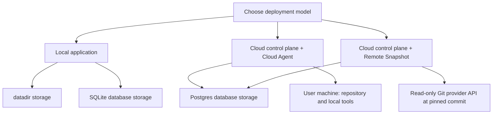

# Kode Stream Architecture

A Go backend and a React frontend give workflow views over Git-backed planning content. This page covers system
boundaries, packages, data ownership and the main flows. Behavior details live in the [wiki](../../wiki/index.md).

## Principles

- Source content stays in Git. App state stays outside managed repositories.
- Repository writes are explicit, scoped and guarded.
- Cached indexes serve the board, search, explorer and graph.
- Transport concerns stay at the API boundary.
- Workspace content is untrusted input.
- Integrations are optional and isolated from core workflows.

## Deployment Model



| Model                           | Runs on                                                    | Workspace boundary                                                                  | Storage                        |
|---------------------------------|------------------------------------------------------------|-------------------------------------------------------------------------------------|--------------------------------|
| Local application               | User machine (Homebrew, local build or Docker)             | Local paths and managed clones. Git, writes, terminal, AI and verification run here | `datadir` or SQLite `database` |
| Cloud Agent-Backed              | Cloud API on a VM or container, Cloud Agent on user machine | Agent connects and publishes metadata. Command delivery returns 503                | Postgres `database`            |
| Cloud Agentless Remote Snapshot | Cloud API on a VM or container                             | Read-only provider reads at a resolved commit. No checkout or process in Cloud      | Postgres `database`            |

"Cloud mode" does not mean every workspace has an Agent. See the
[Cloud runtime reference](../../wiki/platform/cloud-runtime-reference.md) and the
[storage reference](../../wiki/platform/storage-reference.md).

Mode diagrams: [Local mode](local-mode/README.md), [Cloud mode](cloud-mode/README.md). The runtime mode is configuration and policy, not one
`DeploymentMode` interface. `StorageProvider` and `workspaceAccessAdapter` carry what varies. See
[deployment adapters](deployment-adapters.md).

## Code Layout

`cmd/` holds the composition root. `internal/` and `web/` hold the logic and every test. `internal/server` declares
`//go:embed all:frontend`, so one binary, one image and one Homebrew formula carry the whole product.

```text
              web/src/                          internal/
         (React frontend)          agent  ai  audit  canvas  filesystem  git  item
                  │                jira  knowledge  navigation  provider  search
                  │                server  storage  system  verification  workspace
                  │                cloudstate  common  e2eresult  harness  runtime  workstream
                  │                                     │
                  │  npm run build → embedded           │
                  └──────────────────┬──────────────────┘
                                     ▼
                                   cmd/
                              kode-stream
                                     │
                     ┌───────────────┴───────────────┐
                     ▼                               ▼
              kode-stream image              Homebrew formula
       deploy/docker/image/kode-stream/      cmd/scripts/distribution/
```

`cmd/scripts/distribution/` holds release automation. CI runs it, so it stays beside the code it releases.

Gin lives only in `internal/server/api`. Domain packages take standard contexts and primitive parameters, never
framework request objects, so their tests need no server.

## Backend Packages

| Package                 | Role                                                                      |
|-------------------------|---------------------------------------------------------------------------|
| `cmd/kode-stream`       | Starts the server and runs diagnostics                                    |
| `internal/server`       | Wires services, resolves paths, serves the embedded frontend              |
| `internal/server/api`   | Routes, middleware, request parsing and JSON responses                    |
| `internal/common`       | Errors, HTTP helpers and shared DTOs                                      |
| `internal/filesystem`   | Guarded path validation, bounded reads and writes                         |
| `internal/storage`      | Storage option, providers, SQL migrations, status and sync                |
| `internal/workspace`    | Registration, import, scanning, source settings, files, health            |
| `internal/workstream`   | Checkout board loading, commit-pinned branch review, filters              |
| `internal/item`         | Item detail, Markdown writes, metadata, status, creation, refresh         |
| `internal/search`       | Item search, content search and path search                               |
| `internal/knowledge`    | Wiki indexing, graph, sync, reads and enrichment                          |
| `internal/git`          | Status, fetch, pull, push, commit, branch create and switch               |
| `internal/jira`         | Issue lookup, REST access, caching and guarded attachments                |
| `internal/ai`           | Provider detection, settings, external launch, embedded sessions          |
| `internal/verification` | Bounded verification jobs, status, checkpoints and artifacts              |
| `internal/system`       | Config paths, native dialogs, path reveal, health, diagnostics            |
| `internal/audit`        | Operation event append and query                                          |
| `internal/navigation`   | Saved filters and recent items                                            |
| `internal/canvas`       | Branch-scoped layouts, placements, references and projections             |
| `internal/harness`      | The engineering harness. See [the harness page](../../wiki/platform/harness.md) |

## Frontend Areas

| Path                                   | Role                                                     |
|----------------------------------------|----------------------------------------------------------|
| `web/src/App.tsx`                      | Layout and top-level navigation                          |
| `web/src/app/useAppState.ts`           | Workspace, route, refresh, theme and stale state         |
| `web/src/shared/api`                   | Fetch wrapper and endpoint methods                       |
| `web/src/pages/WorkstreamPage.tsx`     | Board, cards, filters, intake and preview drawer         |
| `web/src/pages/WorkspacesPage.tsx`     | Workspace setup, import, edit, delete, scan, reveal      |
| `web/src/pages/ItemWorkspacePage.tsx`  | Files, preview, editor, diff, metadata, Jira, Git tools  |
| `web/src/pages/WorkstreamExplorer.tsx` | Embedded tree, file editor, content search, inspector    |
| `web/src/pages/CanvasPage.tsx`         | Agent Space: the Sessions view and the Canvas            |
| `web/src/pages/BranchReviewPage.tsx`   | Read-only plans and files from a pinned non-checkout ref |
| `web/src/features/*`                   | Feature modules                                          |
| `web/src/shared/*`                     | Reusable API, domain and UI code                         |

Shared modules never import pages. Pages compose feature and shared modules.

## Data Ownership

| Owner      | Examples                                                                                 | Write policy                                     |
|------------|------------------------------------------------------------------------------------------|--------------------------------------------------|
| App state  | Workspace registry, indexes, audit, UI settings, Canvas placements, safe session records | Kode Stream writes to the selected storage option |
| Repository | Markdown, metadata, wiki pages, Git history                                              | Written only through explicit user actions       |

Indexes are derived, and a scan rebuilds them. Canvas stores only layout. It resolves labels, Git state, verification
and process availability from their owners on read.

## Item Discovery

The scanner evaluates each configured source in this order:

1. Source mappings: rules in `.kode-stream/workspace-settings.yaml` whose `fields.source` names the source, else
   `workspace-settings.yaml` inside the source.
2. Structured item folders.
3. Freestyle Markdown docs.

Metadata precedence:

1. `plan.yaml`
2. Source mapping fields and README heading
3. README heading and inferred status
4. Folder names and fallback defaults

Workflow statuses are `draft`, `in_progress`, `review`, `done` and `unsorted`.

## Core Flows

```text
Scan
  -> validate workspace configuration and read configured sources
  -> apply source mappings, parse metadata, headings, Markdown and Git metadata
  -> update derived indexes; report warnings without blocking valid items

Load an operational page
  -> resolve the current checkout and commit
  -> reuse the branch index if commit, source configuration hash and working-tree hash match
  -> otherwise replace the branch rows in one transaction

Write
  -> validate workspace, item, file identity, path scope and content hash
  -> write, rescan affected data, refresh open views
```

Branch Review, plan import and the shared workspace mutation lock are in the
[checkout reference](../../wiki/domains/workspace/reference/branch-context-reference.md). Wiki taxonomy is in the
[taxonomy reference](../../wiki/domains/knowledge/reference/wiki-taxonomy-reference.md).

## API Structure

| Family       | Scope                                                                       |
|--------------|-----------------------------------------------------------------------------|
| Health/audit | Health checks and recent operation events                                   |
| Navigation   | Saved filters and recent items                                              |
| System       | Config paths, native pickers, path reveal, diagnostics                      |
| State/search | App state, item search, content search, AI settings, capabilities           |
| Workspace    | Workspace CRUD, import, scan, runtime, source settings, files, tree, search |
| Item         | Item detail, files, writes, metadata, status, diff, Jira, verification      |
| Knowledge    | Wiki reads, graph, rescan, sync, enrichment                                 |
| Verification | Job creation, checkpoint ingest, status, artifacts, reruns                  |
| Git          | Status, activity, branches, fetch, pull, push, commit, branch operations    |
| Streaming    | Workspace creation events and embedded session channels                     |
| Canvas       | Default resolution, branch-scoped projections, placements, viewport         |
| Harness      | Tasks, runs, approvals, settings, events, bot routes                        |

The [API transport reference](../../wiki/platform/api-transport-reference.md) covers middleware and error codes.

## Safety

- File access stays inside registered workspace sources.
- Path traversal, `.git` access and symlink escapes are rejected.
- Markdown writes need the expected content hash.
- Previews sanitize or escape workspace content.
- Git commits stage only selected paths.
- Credentials, prompts and terminal content never enter managed repositories or SQL.
